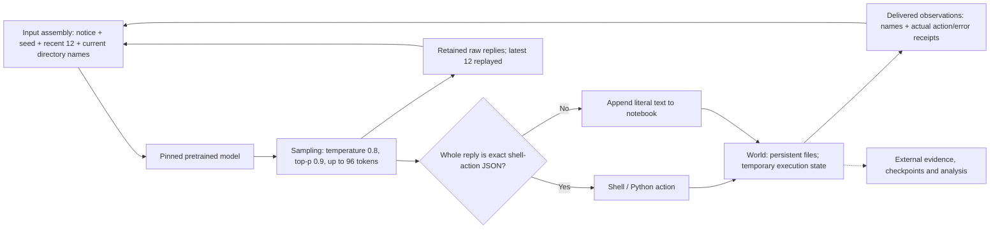

# One-page map: the garden we actually have

9 November 2026 UTC. Design review only. Canonical garden paused at **1550**; no changes or model calls in this review. [Detailed boundary review](BOUNDARY_REVIEW.md).

**Aim:** simple, stable rules permitting complicated behavior, with the model free to act within them and observers recording consequences externally. The current setup only partly meets that aim.

| Part | Current mechanism | What is necessary; what is chosen |
| --- | --- | --- |
| State | Four persistent files at 1550; read-only OS/software; temporary processes during actions | Some explicit state is necessary. Shell/Python and this file layout are design choices. |
| World transitions | Exact action executes a script; other text appends to notebook; actual failures return receipts | A defined action-to-effect rule is necessary. This JSON schema and default writing route are choices. |
| Observation | Directory names supplied every turn; action/error output returned; file contents require actions | Some perception is necessary. Repeating names while omitting contents is a choice. |
| Continuity | Latest 12 raw replies and their receipts are inserted automatically; old books are readable files | A mechanism carrying past experience is necessary for continuity. Twelve-turn replay is one choice; storage alone is not retrieval. |
| Model body | Pretrained SmolLM2-135M-Instruct; fixed weights; fresh KV cache each reply | The model brings prior capabilities. It does not learn new weights in this run. |
| Output selection | Temperature 0.8, top-p 0.9, 96-token output bound | Generation needs a selection policy and finite budget. These particular settings are choices. |
| Experimental bounds | Isolation, storage/process/time/context limits, supported checkpoint states | Keep explicit finite bounds. Their values are engineering choices, not universal cognitive laws. |
| Observer | Full raw evidence and checkpoints; interpretations stay external | Observation must remain accurate. Raw-reply replay is an explicit feedback channel; it is not merely passive observation. |

**Conway comparison:** a small transition rule can support rich patterns. Our current world instead inherits a large software stack, with a narrow observation/action connection. A brief notice does not make the underlying OS simple. A finite implementation also has bounded capacity; computational universality does not establish discoverability, sufficient resources, or emergence by this model.

**Established restriction:** at the current repeated input, all 32 next-token nuclei along the directory-list reply, including EOS, contain one token. The preceding audit confirmed this with the original generator. The action path works on a disposable checkpoint; spontaneous model use remains unestablished. An input-changing event can invalidate the loop conditions.

**Simplification target:** retain isolation, defined consequences, truthful receipts and recoverable history; explicitly choose the smallest usable perception, action and continuity arrangement. Treat replay length, repeated directory cues, action syntax and sampling as experimental choices. Removing a mechanism must account for the function it carried. No selected replacement is implemented here.

Garden translation: the soil has rules, but so do the window, memory and doorway. Simplifying the whole experiment means accounting for all four.
