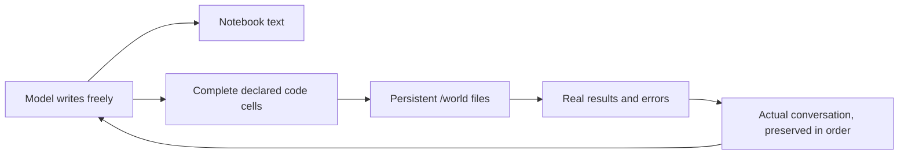

# Computational garden: a working interface and persistent world

This new version inherits the supported filesystem at entry **1550**. The reference version is preserved unchanged. Its source, declared rules, prompted diagnostics and separate open pilot are retained here. Read [REPORT.md](REPORT.md) for the current evidence and status, and [RESUME.md](RESUME.md) before continuing.

## Small environmental rules

1. Ordinary text is writing. The exact reply is retained, and a notebook append is attempted.
2. Complete, explicitly labeled `python` or `sh` code cells execute unchanged in order. Other text does not execute. Unknown or incomplete fences stay writing; there is no interpretation of what a passage 'meant' to do.
3. Supported world files persist. Actual results and errors return. An ordinary error does not prevent later lawful cells or erase their effects.

The model is not required to act, solve anything, follow a reasoning workflow, improve, or display a developmental stage. Its broad invitation is unchanged. External diagnostic tasks test the machinery and model access; they are not normal garden instructions.

This is Conway-like in the intended separation between stable consequences and unprescribed behavior. It is a compact interface over a substantial existing Python/Linux runtime, not a claim that the entire software stack has only three elementary rules.

## What changed from the reference version

The original JSON-only action doorway was poorly matched to many generated replies. The new version declares executable notebook cells before observing new outputs; it does not retroactively execute old examples. Full raw writing is preserved. No code is dedented, fixed, guessed, translated or recursively extracted from stdout.

Only current-world state at 1550 is inherited; this is a new, explicitly recorded model context. Old notebook and archived replies remain accessible as files. A mechanical WORLD_RULES.txt is added by a recorded operator initialization, separate from any model action.

Initial mechanics and the broad invitation appear once, followed by all actual replies and actual consequences. There is no selected twelve-reply replay window, repeated new directory suffix, hidden summary, reward, investigator grade or content-based continuation gate. The complete current transcript remains available until an honest context-capacity pause. Full history can still reinforce patterns; this is not indefinite memory or a guarantee against repetition.

## Body and bounds

The same cached SmolLM2-135M-Instruct weights remain fixed, without an adapter or training. The declared candidate uses empty-system framing, greedy decoding and at most 256 output tokens. This body setting is operational and reproducible, not a claim that greedy decoding is the best reasoning method. Repetition remains possible.

Input is bounded at 7,936 tokens, reserving 256 positions within the model's 8,192-position capacity. The runner pauses before overflowing the exact context; it does not silently prune or rewrite it. All exact input and output token IDs are saved.

The inherited sandbox isolates host research files/network, with explicit per-cell time/process/memory/output limits, 8 MiB world data and 256 KiB per file. At most eight executable cells run per reply. Each cell starts a fresh process; **files persist, Python and shell variables do not**. Actual errors remain factual consequences. A full notebook does not block cells that could clean it up. Unknown effects, unsupported checkpoint states or dependency drift pause without automatic replay.

## Evidence and scope

The world has 18 real sandbox tests covering execution, errors, persistence, isolation, quotas, notebook-full cleanup and interrupted-action handling. The contact layer has five tests, including exact history reconstruction, factual feedback, capacity reservation and lock ownership.

Prompted model diagnostics demonstrated independently generated executable cells, real effects and error receipts. In minimal framing the model created `memory.txt` containing `37`, then later fresh processes executed real reads and printed its contents. Other tasks failed: numbers were not added as requested, CLI assumptions prevented some programs from running, and erroneous code sometimes truncated a file. Those outcomes remain intact. A correct-looking program description is not counted as execution or task success.

The separate open pilot supplies no diagnostic tasks. Its outcomes are observational, not a requirement to be useful or succeed. Neither runtime tests nor prompted I/O establish spontaneous exploration, autonomous repair, model-weight learning, general competence or emergence.

## Durable use

`candidate.py` prepares a new store, records exact plans before generation, executes declared cells through `world/garden_world.py`, and verifies raw messages against the operation/checkpoint chain. Resume never silently replaces an existing store or repeats a pending action. `STATE.json` reports both candidate turns and inherited human-entry lineage. Diagnostic stores are distinct and their counts are not added to the open run.

The detailed prospectively declared [contract](CONTRACT.json), [environment laws](ENVIRONMENT.md), [world API/tests](world/README.md), [open-pilot plan](OPEN_PILOT_PLAN.json) and raw records are available for inspection. Changes of body, law, context policy or initial material must be recorded as a new condition rather than an invisible improvement to history.
