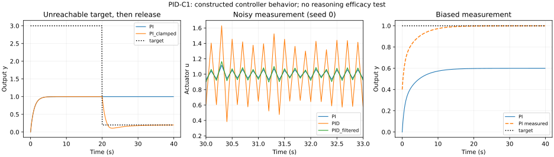

# PID-C1: feedback mechanics and evidence-valid reasoning

The user's PID screenshot motivates a useful comparison: PID regulates a measured quantity, whereas reasoning also has to decide what to measure, what the target means, and which proposed explanation or correction is warranted. We can borrow control mechanics without treating low measured error as truth. This contact supplies a numerical illustration and an optional candidate procedure; it does not demonstrate improved AI reasoning.

## Established mechanism and the analogy

For error e = reference − measured output, a parallel PID controller uses u = Kp e + Ki integral(e dt) + Kd de/dt. P reacts to current mismatch, I accumulates mismatch over time, and D responds to change. Practical implementations can differentiate measurement instead of error, filter derivative action and limit integral accumulation during actuator saturation. Derivative action estimates a local trend; it does not observe the future. A PID controller carries state through its integral/filter, even if the agent applying a single update has no persistent private memory.

The useful reasoning analogy is regulation of attention or intervention effort. A current discrepancy can trigger examination; a persistent unresolved discrepancy can remain on the agenda; a changing measured outcome can change intervention strength. The inference itself still needs task knowledge and evidence. Repeated discrepancy is not repeated independent evidence. A controller's integral must not become an automatic confidence accumulator.

## Prospectively fixed numerical contact

[PROTOCOL.md](PROTOCOL.md), [SETTINGS.json](SETTINGS.json), [LAUNCH_MANIFEST.json](LAUNCH_MANIFEST.json), and [the simulator](../../experiments/pid_contact.py) were deposited before execution. One scalar first-order plant, seven controllers, three deterministic scenarios and 30 paired noisy-sensor seeds: **231 runs, not 231 independent experiments**. Each run has 400 steps of 0.1 s. No model calls, gain optimization or post-result tuning. Exact gains and signal construction are in settings. Derivative uses measurement differences; clamping uses conditional integration. The noise deliberately includes a high-frequency alternating component.

All four predictions were met within this construction:

| Contact | Result | Scope |
|---|---|---|
| Constant load | Tail true MAE P 0.777778; PI 0.000065 | Integral action removes this steady offset. |
| Saturation release | PI and PID did not recover within the 20 s post-drop window; clamped PI recovered in 5.9 s, clamped PID in 6.2 s, filtered/clamped PID in 6.5 s. | Integral accumulation under a prolonged unreachable target causes slow recovery. Null recovery is horizon-censored, not permanent failure. |
| Noisy sensor, 30 paired seeds | Mean actuator total variation PID 307.459; filtered PID 58.086; PI 40.889. Mean true tracking MSE respectively 0.025908, 0.025268, 0.024317. | Filtering reduced derivative-induced movement; PI was still simpler and better on these two measures. |
| Biased sensor +0.4 | PI tail measured MAE 0.000025, true MAE 0.400025. | Almost perfect displayed correction can coexist with materially wrong true state. |

PI also had slightly lower full-horizon tracking MSE than the PID variants in the constant-load case. There is no universal winner. Common hand-selected gains do not establish the best attainable performance of each controller. Extra terms add opportunities for failure as well as control.

Checks passed: finite trajectories; every applied actuator within its declared bounds; unchanged launch hashes; analytic P fixed point 0.22222222222222224 versus last recorded output 0.22222222222222218 (absolute error 5.55e-17). These checks concern implementation consistency. Four expected outcomes in a designed toy are no independent mechanism discovery. Internal simulation compute was about 0.43 s; that excludes research, plotting and publication time.

[SUMMARY.json](SUMMARY.json) preserves every scenario/controller summary; [RUN_METRICS.jsonl](RUN_METRICS.jsonl) preserves every individual run's metrics. Full trajectories are retained locally in RESULTS.json and RESULTS.json.gz; these large files are **not** part of this GitHub deposit. [RAW_ARCHIVE_MANIFEST.json](RAW_ARCHIVE_MANIFEST.json) records their hashes, paths and environment; the exact simulator/settings regenerate them. Runtime metadata varies on regeneration. Raw stdout and stderr are retained too.

## Connection to the existing FRR evidence

The earlier [role/reference contact](../EVIDENCE_GATED_ROTATION_REPORT.md) already showed the importance of checking reference provenance: a constructed audit aimed at a wrong inherited reference could worsen the task even when its noise stream was independent. Provenance was supplied by construction, not reliably discovered by an agent. PID-C1 supplies a related physical-control illustration, not independent confirmation of semantic behavior.

[REV-C1](../revision-continuity-v1/REPORT.md) showed preservation of corrections plus acceptance of newer scoped evidence in two small fictional histories. Ordinary guidance and compact FRR tied at the rubric ceiling. It supports feasibility in those cases; it supplies no demonstrated advantage for a new PID-inspired algorithm. Do not retrofit this procedure as what all previous agents used.

## Extracted candidate and next test

The optional [evidence-gated feedback procedure](../../modules/evidence-gated-feedback.md) is a concrete synthesis: validate the measurement/reference, choose a discriminating action, bound accumulated intervention pressure, check the proposed change, preserve the correction and its scope. It is an inspectable procedure, not a trained policy or validated optimal algorithm. Use an actual numeric PID scheduler only where a stable measured variable and controllable response are defined. Otherwise retain qualitative bookkeeping instead of inventing numerical epistemic precision.

The next discriminating behavioral test should independently prepare tasks where repeated internally consistent but wrong readouts compete with an accessible authoritative correction. Compare ordinary review, the candidate, and a simpler provenance-check-only procedure under matched opportunity budgets; measure grounded correctness, justified reversals, unnecessary interventions and cost. Include a correct but noisy readout so excessive doubt can lose. Freeze tasks/scoring separately before participants, and retain abstentions and failures. No such participant trial ran here.

## Sources and access limits

- [MathWorks PID Controller documentation](https://www.mathworks.com/help/simulink/slref/pidcontroller.html): controller structure and practical derivative/filter features. Official page read.
- [MathWorks anti-windup example](https://www.mathworks.com/help/simulink/slref/anti-windup-control-using-a-pid-controller.html): saturation, accumulated integral and clamping/back-calculation. Official page read.
- [Stuart Russell, Metareasoning (1997)](https://people.eecs.berkeley.edu/~russell/papers/mitecs-metareasoning.pdf): selecting computations and deciding when to stop based on possible decision benefit and cost. Full seven-page PDF read. A useful established relative, not proof this candidate works.

Caltech/FBS textbook attempts returned timeouts or an error; no claim that those chapters were read. This is a targeted source contact, not an exhaustive control/metareasoning literature review. No novelty claimed for feedback, metareasoning, provenance or anti-windup.
